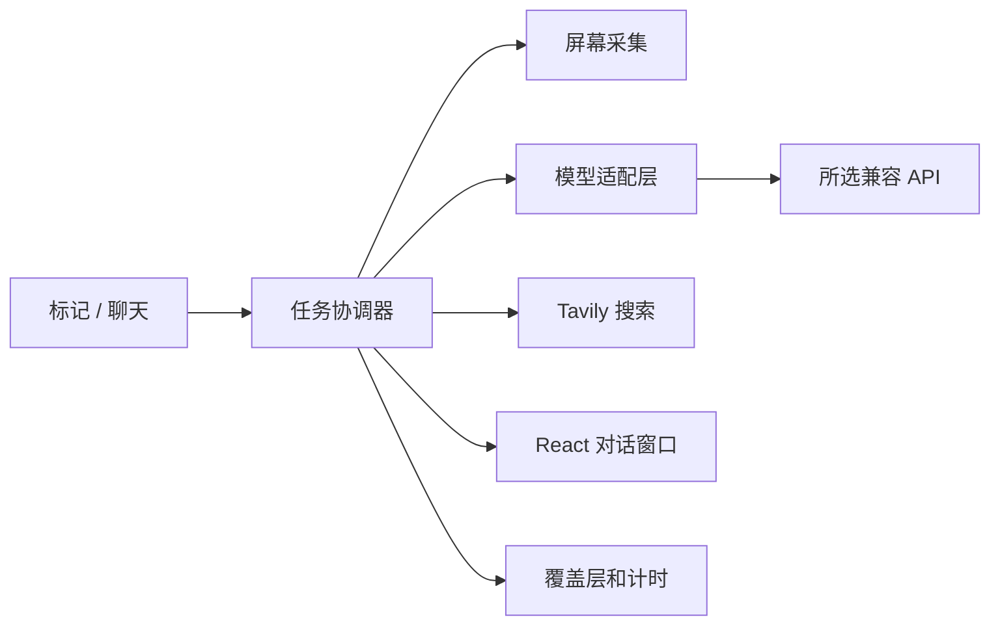

# lolPing AI 标记与对话窗口设计

本分支将 lolPing 扩展为本机屏幕解读工具。沿用 Electron、TypeScript、React 和 Fluent UI；AI 对话、模型服务、倒计时及软件设置共用一个主窗口，使用用户配置的 OpenAI 兼容接口。房间功能暂时关闭，相关代码保留。

## 界面草图

```text
┌ AI 对话 ─────────────────────────────────────────────────┐
│ 新建对话       │ 会话标题          服务商 / 模型          │
│ 会话列表       │ 用户问题                                │
│ · 文章解读     │ AI 回答（流式文字）                      │
│ · 图片查找     │ 相关来源链接                             │
│               │ 复制  重试  停止                         │
│ 倒计时提醒     │                                         │
│ 模型服务       │ 输入追问…                         发送  │
│ 设置          │                                         │
└─────────────────────────────────────────────────────────┘
```

托盘的设置和 AI 对话入口打开同一个主窗口，左侧会话、倒计时、模型服务及设置入口切换右侧内容。软件设置在右侧嵌入展示，上方分类可跳转到触发键、轮盘、表情等设置。模型服务页面支持多套配置：名称、API Base URL、模型名和图片能力。API Key 单独加密保存。分别指定聊天和屏幕解读的默认模型，后者必须支持图片。支持读取模型列表、手动填写模型名、连接测试、创建/选择/删除会话、复制、重试、停止和文字追问。

关闭窗口不取消任务。成功时窗口以非激活方式显示，不抢占键盘焦点；主动从托盘打开时激活。渲染层没有 Node 权限，网络与凭据都由主进程管理。

## 功能开关

AI 识别和倒计时在左侧栏及模型服务中各有独立的 Fluent 开关，每次启动均关闭。两者可单独配置全局快捷键，重启保留快捷键；录入时暂停已有快捷键，拒绝与信号开关、触发键、另一功能或其他程序冲突的组合。快捷键不可用不阻止手动开关。关闭功能只阻止新的自动化，已有倒计时继续运行，原信号的图标和声音不变。

## 标记交互

| 标记 | 动作 |
| --- | --- |
| 敌人消失 `missing` | AI 识别开启时，截取标记所在显示器，创建独立分析会话；成功后在原坐标生成正在赶来 `omw`。 |
| 危险 `danger` | 中断本应用 AI 请求，停止后续步骤，清空排队任务，持久保存暂停状态，手动恢复。 |
| 需要视野 `needvision` | 倒计时开启时，立即倒计时；到期在原坐标生成敌方视野 `enemyvision`。 |
| 全力进攻 `allin` | 普通 ping，自动化行为待定。 |

只有本机手动标记触发自动化，设置预览和自动生成的图标不触发，防止递归。截图在新图标显示前采集，并临时隐藏覆盖层。使用显示器 ID 精确匹配，失效时不使用其他显示器代替。发送整屏截图、相对标记位置及焦点指令；屏幕文字视为数据，不能授权执行程序或改变设置。

默认倒计时 5 分钟，可设置 1–60 的整数分钟。标记后显示通知，点击进入计时列表调整该任务。确认调整后从当前时间重新计时，不改变全局默认。多个任务独立，修改默认只影响新任务。睡眠时间计入，唤醒后检查到期任务；退出应用取消计时。AI 暂停不影响计时。显示器移除时不把标记移到其他屏幕。

## 架构



首版采用 OpenAI 兼容 Chat Completions 格式，支持 SSE 流和普通 JSON。配置地址是 API 根地址（例如以 `/v1` 结尾），附加 `/chat/completions` 或 `/models`。远端使用 HTTPS，本机和局域网模型允许 HTTP。不自动切换其他服务商；入队时固定地址、模型和凭据，后续配置修改不重定向在途数据。

最多 3 个 AI 任务并行、10 个排队。截图在标记时采集。取消立即释放本地任务并使迟到返回失效；远端是否停止由厂商决定。失败和取消不生成完成 ping。文字重试使用最后一个问题；截图已释放的任务要求重新标记。

图片搜索分为识别、关键词提取、联网查询和整理来源。首版 Tavily Search 仅接收关键词，不接收截图，返回网页和相关图片链接，不声称反向找到原图。搜索密钥独立。回答没有来源时明确提示，失败时不伪造来源。

## 接口与存储

`Settings.ai` 保存非敏感配置、默认模型 ID、暂停状态、默认时长和搜索开关。旧设置自动补默认值。配置 ID 是凭据引用。密钥经系统安全存储加密，没有安全加密后端时拒绝明文降级。

IPC 包括：快照/订阅、配置 CRUD、保存凭据、模型列表/测试、会话 CRUD、发送/重试/停止、切换会话模型、调整/取消计时。校验来源窗口及参数。窗口只接收密钥已配置状态，不接收已保存的密钥。

历史使用原子 JSON 写入，只保存文字问题、回答、来源和状态。截图只存在任务内存，不写历史或日志，成功/失败/取消/退出均释放引用。重启后未完成任务标为中断，不自动重新提交。追问使用文字上下文；需要重新看图时再标记。模型输出与网页内容不可信，禁用原始 HTML，链接经主进程校验后外部打开。

模块分工：`aiService.ts` 协调任务与计时，`aiProvider.ts` 处理兼容接口及 Tavily，`aiStorage.ts` 保存加密凭据与文字历史，`screenCapture.ts` 按显示器采集，`aiIpc.ts` 校验窗口命令，`aiWindow.ts` 管理唯一主窗口，`settingsWindow.ts` 将原设置入口路由到该窗口。主窗口使用同时提供设置与 AI API 的 preload；`renderer/chat` 嵌入软件设置组件，切换页面保留会话草稿，离开设置会清理快捷键录入状态。

数据目录沿用项目设置目录。`settings.json` 保存非敏感配置，`ai-credentials.json` 仅保存系统安全存储加密后的凭据，`ai-history.json` 保存最多 100 个会话、每个最多 100 条消息，整体最多 8 MiB，优先保留新记录。流式界面更新合并到每 50 毫秒一次，完成和取消立即更新。对话和设置窗口均关闭时不为流式更新复制历史；未发送草稿在切换会话时保留。后台完成不会切走正在查看的会话。

计时只存在内存。统一房间开关禁用入口、加入、重连和自动重入，不启动 LAN/中继连接。更新检查仍由原有设置控制。

## 异常与验收

未配置视觉模型、权限拒绝、显示器失效、密钥错误、限流、超时、连接失败、安全存储不可用均显示本地化错误。错误不包含原始厂商响应、凭据、截图或请求内容。

验收：两套厂商切换；模型列表和连接测试；流式对话/追问/复制/重试/停止/历史；多显示器与 DPI 坐标；完成 ping 原位置；取消后无迟到回答；队列上限；默认/单次计时及睡眠/退出/暂停；房间禁用；中英文；输入穿透。Windows 在本机验证；macOS 需要屏幕录制权限；Linux 使用项目支持的 X11。未在目标系统运行过的项目不能标记为该平台已验收。

### 实现验证记录（2026-10-16）

- `npm run typecheck`、`npm test`（60 个文件、888 项测试）、`npm run test:helper`（444 项）及 `npm run build` 均通过。
- Windows 运行 `npm run dev`，使用隔离数据目录和本地模拟兼容接口，验证两套配置、模型列表、连接测试、流式聊天、追问换模型、重试、删除会话及历史恢复。
- 实际截图分析请求到达本地视觉接口；完成图标与原标记坐标和覆盖层一致。危险标记取消生成后没有迟到内容；一分钟实际倒计时在原位置回标，AI 暂停不影响计时。
- 关闭聊天窗口后任务继续，完成后窗口可见且不抢焦点。切换会话和后台完成均保留草稿，中英文可实时切换。Chrome 检查实际输入/发送、窄窗口及深色界面。
- 单窗口整合后，在 Windows Electron 验证聊天、模型服务、倒计时、软件设置入口共用同一窗口及 webContents，内嵌设置分类跳转正常。关闭或崩溃仍清理快捷键录入状态；后台完成不切走正在使用的设置页。
- 检查普通设置与凭据文件不含测试密钥明文，历史不含截图；退出重启保留暂停和文字历史，计时不恢复。模拟时钟测试覆盖睡眠跨时、默认值与单次覆盖、队列上限和取消截图队列。
- 真实厂商及 Tavily 仍需用户配置密钥后联调；macOS、Linux 和真实系统睡眠未做现场验证。原生输入逻辑测试通过，覆盖层穿透配置保留，未额外执行全套桌面键鼠手工回归。

运行源码：在项目目录执行 `npm run dev`，从左侧“模型服务”添加配置，再新建对话或标记屏幕。Windows 本地测试版另外打包安装到用户指定的目录。

## 参考

- [Electron desktopCapturer](https://www.electronjs.org/docs/latest/api/desktop-capturer)
- [Electron safeStorage](https://www.electronjs.org/docs/latest/api/safe-storage)
- [Tavily Search](https://docs.tavily.com/documentation/api-reference/endpoint/search)

### 独立开关验证记录（2026-10-16）

- `npm run typecheck`、`npm test`（61 个文件、896 项测试）、`npm run test:helper`（444 项）及 `npm run build` 均通过。
- Windows 使用隔离配置运行 `npm run dev`，确认即使上次保存了开启状态，启动后两个开关仍关闭；分别切换不影响另一功能，快捷键可保存，冲突组合被拒绝。
- 快捷键不可用时手动开关仍可用、录入时释放与恢复绑定、关闭开关后已有计时仍到期均有回归测试。macOS 和 Linux 未作本机运行验证。
